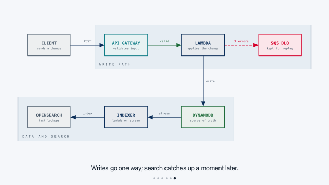
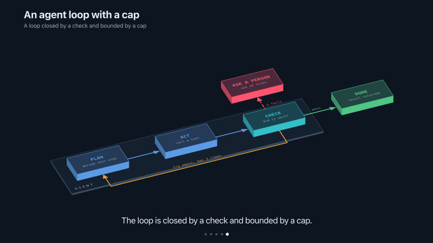

# Scene plates

Animated 3D diagrams for HTML decks, drawn from a small JSON spec.


You, or an AI model, write about fifty lines of JSON saying what the boxes are,
how they join, and what happens at each step. The runtime does the drawing, the
camera and the animation. Because no one writes drawing code per diagram:

- **Every diagram looks the same.** Colours, fonts, sizes and timings live in
  one file, [`src/tokens.ts`](src/tokens.ts). Change the brand there.
- **A model spends few tokens.** It writes the spec, not hundreds of lines of
  graphics code, and an edit is a few changed lines.
- **Bad diagrams are refused.** A checker rejects overlapping boxes, crossing
  lines, labels that do not fit, text too small to read, and loops with no cap.
- **Nothing to install on the page.** One 25 KB script, no other libraries, no
  network. It also renders stills and GIFs from the command line.

It is a parallel-projection 3D view drawn as SVG, not WebGL. That keeps text
sharp at any size and lets the same code run in a browser and in a terminal.
The camera can turn and tilt within the range where labels stay readable.

## Try it

Needs [Bun](https://bun.sh).

```sh
bun install
bun src/cli.ts check examples/*.json               # are the specs sound?
bun src/cli.ts html examples/*.json -o deck.html   # a standalone deck
open deck.html                                      # arrows, space or click
```

[`examples/deck.html`](examples/deck.html) is that output, ready to open.

## Examples

| Spec | Shows |
|---|---|
| `01-flow-simple` | a five-box flowchart with one decision |
| `02-flow-complex` | ten boxes, two plates, two capped loops, a zoom onto one part |
| `03-aws-simple` | a serverless web app on one layer |
| `04-aws-landscape` | three layers, with a VPC plate holding public and private subnets |
| `05-aws-events-flat`, `06-aws-events-iso` | the same scene drawn flat and in 3D |
| `07-request-flow`, `08-agent-loop` | two layers with a fail path; a loop with a cap |

## Flat or 3D from one spec

Add `"view": "flat"` and the scene is drawn from straight above. Layers become
bands, top layer first, and lines between layers become ordinary arrows. Any
spec can be drawn either way: `--view flat` on the command line, or
`<scene-plate view="flat">` on a page.

| Flat | 3D |
|---|---|
|  |  |

Stacking is what 3D buys: the three-layer landscape above fits a slide in 3D
and is refused as too small to read when drawn flat.

## A spec

```json
{
  "title": "An agent loop with a cap",
  "description": "An agent plans, acts and checks its own work, at most three times.",
  "nodes": [
    { "id": "plan", "label": "PLAN", "sub": "decide next step", "at": [0, 0] },
    { "id": "act", "label": "ACT", "sub": "call a tool", "at": [3.4, 0] },
    { "id": "check", "label": "CHECK", "sub": "did it work?", "kind": "gate", "at": [6.8, 0] }
  ],
  "edges": [
    { "from": "plan", "to": "act" },
    { "from": "act", "to": "check" },
    { "from": "check", "to": "plan", "kind": "loop", "via": "y", "channel": 1.75, "label": "try again, max 3 times" }
  ],
  "steps": [
    { "caption": "The agent plans a step and acts on it.", "show": ["plan", "act"], "pulse": ["plan>act"] },
    { "caption": "Then it checks the result.", "show": ["check"], "pulse": ["act>check"] },
    { "caption": "A failed check sends it round again.", "pulse": ["check>plan"], "camera": { "pitch": 46 } }
  ]
}
```



The full format, the colour meanings and the six moves (`show`, `hide`,
`focus`, `pulse`, `camera`, `caption`) are in
[`skill/scene-plates/SKILL.md`](skill/scene-plates/SKILL.md). That file is also
a ready-made skill for Claude Code: copy the `scene-plates` folder into your
skills folder and set `SCENE_PLATES_HOME` to where you cloned this repo.

## In your own page or deck

```html
<script src="dist/scene-plates.min.js"></script>
<scene-plate src="diagrams/request-flow.json"></scene-plate>
```

The element offers `next()`, `prev()`, `go(i)`, `restart()`, `step` and
`stepCount`. `next()` returns `false` on the last step, so a deck can advance
its own slide. It follows the system light or dark setting unless you set
`theme`, and it holds still for people who ask for reduced motion.

## Other outputs

```sh
bun src/cli.ts svg spec.json --all -o out/           # one still per step
bun src/cli.ts svg spec.json --step 3 --theme dark   # one still to stdout
bun src/cli.ts check spec.json --view flat           # would it also work flat?
bun scripts/gif.ts spec.json out.gif                 # needs rsvg-convert and ffmpeg
```

## How it is put together

| File | Job |
|---|---|
| `src/tokens.ts` | every colour, font, size and timing |
| `src/spec.ts` | the spec format |
| `src/layout.ts` | boxes and right-angled line routes |
| `src/scene.ts` | camera maths and what is on screen at each step |
| `src/validate.ts` | the checker |
| `src/render.ts` | one frame as an SVG string |
| `src/mount.ts` | the browser runtime and `<scene-plate>` |
| `src/cli.ts` | `check`, `svg`, `html` |

`bun test` runs the checks. `bun run build` rebuilds `dist/` and the example deck.

## Limits

- Boxes only: no cylinders, service icons or curved lines yet. Service names go in the labels.
- A line between layers needs one node directly above the other.
- A line that spans more than one layer is drawn in front of the layers between.
- About ten nodes and three layers fit one slide; the checker says when to split.
- Keep to one row of nodes per layer when stacking three layers, or the scene gets too tall.

MIT licence.
