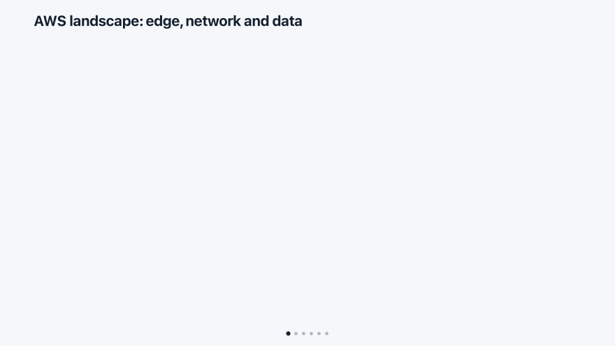
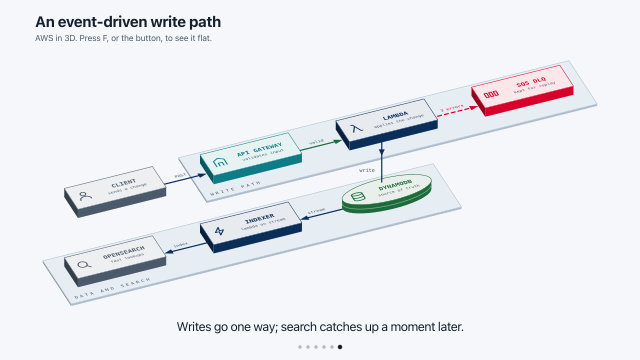
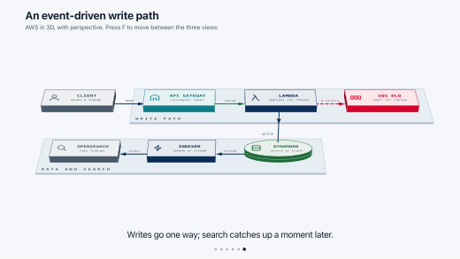
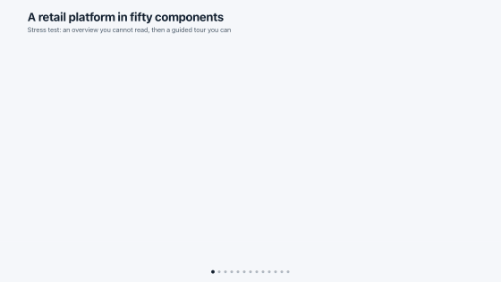

# Scene plates

Animated 3D diagrams for HTML decks, drawn from a small JSON spec.



You, or an AI model, write about fifty lines of JSON saying what the boxes are,
how they join, and what happens at each step. The runtime does the drawing, the
camera and the animation. Because no one writes drawing code per diagram:

- **Every diagram looks the same.** Colours, fonts, sizes and timings live in
  one file, [`src/tokens.ts`](src/tokens.ts). Change the brand there.
- **A model spends few tokens.** It writes the spec, not hundreds of lines of
  graphics code, and an edit is a few changed lines.
- **Bad diagrams are refused.** A checker rejects overlapping boxes, crossing
  lines, labels that do not fit, text too small to read, and loops with no cap.
- **Nothing to install on the page.** One 41 KB script, no other libraries, no
  network. It also renders stills and GIFs from the command line.

It draws 3D as SVG, not WebGL. That keeps text sharp at any size and lets the
same code run in a browser and in a terminal. Each scene can be shown in
perspective 3D, true isometric, or flat.

## Try it

Needs [Bun](https://bun.sh).

```sh
bun install
bun src/cli.ts check examples/*.json               # are the specs sound?
bun src/cli.ts html examples/*.json -o deck.html   # a standalone deck
open deck.html                                      # arrows, space or click
```

[`examples/deck.html`](examples/deck.html) is that output, ready to open once
you have cloned the repo (GitHub shows an HTML file as text, not as a page).

- **[Tutorial](docs/tutorial.md)**: build your first scene in seven short parts.
- **[Gallery](docs/gallery.md)**: every example playing as a GIF, viewable on GitHub.

## Examples

All of these play in the [gallery](docs/gallery.md).

| Spec | Shows |
|---|---|
| `01-flow-simple` | a five-box flowchart with one decision |
| `02-flow-complex` | ten boxes, two plates, two capped loops, a zoom onto one part |
| `03-aws-simple` | a serverless web app on one layer |
| `04-aws-landscape` | three layers, with a VPC plate holding public and private subnets |
| `05-aws-events-flat`, `06-aws-events-iso`, `07-aws-events-3d` | the same scene in each of the three views |
| `08-request-flow`, `09-agent-loop` | two layers with a fail path; a loop with a cap |
| `10-platform-50` | fifty components in thirteen areas, shown whole and then as a guided tour |
| `11-aws-routing` | 27 popular AWS services and 29 lines; each step shows one routing rule |

## Three views from one spec

| View | What it is | Good for |
|---|---|---|
| `3d` (default) | perspective, looking straight on; steps can tilt and zoom the camera | presenting; showing layers |
| `iso` | true isometric: a fixed 45 degree camera and no perspective, so equal lengths stay equal | the classic architecture-diagram look; print |
| `flat` | straight down; layers become bands, top layer first | documents; simple flows |

Set `"view"` in the spec, `--view` on the command line, or `view="iso"` on the
tag. Any spec can be drawn all three ways.

The 3D view faces the scene square on, so rows stay level and text stays
upright. For an angled look, turn it: `"camera": { "yaw": 22 }` (-45 to 45).

| Flat | Isometric | 3D |
|---|---|---|
|  |  |  |

Add the `toggle` attribute and the scene gets a small 3D / Isometric / Flat
control (and the F key) to move between them while you present. Between 3D
and isometric only the camera moves. To or from flat the layout changes, so
lines fade out, the boxes move across, and the other view's lines fade in.
The control offers only the views that pass the checker. Decks made with
`html` have it on; `--no-toggle` leaves it off.

Each view suits a different shape of scene. Isometric turns a long row into a
long diagonal, so wide scenes come out smaller; flat cannot stack, so
many-layered scenes come out smaller. The three-layer landscape above passes
only in 3D.

## Big scenes



Fifty components do not fit one slide at a readable size, and the checker
says so. What works is a map followed by a tour:

- **Seen whole**, a big scene drops the words that would be too small and
  enlarges the area names, so it reads as a map of boxes, icons and districts.
- **Each step moves the camera in** on a few components
  (`"camera": { "target": ["order", "orderdb"], "zoom": 2.4 }`), and the words
  fade back in as they become readable.
- **The checker's rule** is that every component must be large enough to read
  in at least one step. It names the ones a tour has missed and the zoom needed.

`10-platform-50` covers all fifty in twelve stops, in all three views. It
draws in under a millisecond a frame. What made it tractable was layout
discipline: one area per row segment, lines only between neighbours, and the
few long lines routed along the gaps between rows.

## How lines are routed

There is no automatic path-finder. Each line takes one of four simple shapes,
the author nudges it with three settings, and the checker refuses any spec
where lines cross or tangle. `11-aws-routing` walks through the rules.

**The four shapes**

| Shape | When | Path |
|---|---|---|
| straight | the two boxes line up in a row or column | one segment between the facing sides |
| Z | they are in different rows and columns | out of the facing side, a turn in the gap between them, into the facing side |
| L | `"via": "xy"` or `"yx"` | one bend: across then down, or down then across |
| U | same row or column with a box in the way, and `via` set | out into the gap between rows, along, and back in |

**The three settings**

- `via` picks which side a line leaves by.
- `channel` picks the exact column or row where it turns. Two unrelated lines
  turning in the same gap get different channels, a little apart.
- `offset` shifts a line sideways, so a there-and-back pair runs side by side.

**What the checker refuses**

- two lines crossing;
- a line running through a box, including its own;
- two unrelated lines running along each other or meeting part-way;
- a label sitting on a box, a line or another label.

**What it allows**

- Lines that share a box may share a stretch: several leaving one box share
  a stem and branch, several arriving at one box join. Each branch or join is
  marked with a dot.

When a line cannot be drawn without crossing, the answer is to reorder the
boxes, pick which line matters more, or state the link in words. Services
that everything uses, such as logging and access control, get no lines at all.

`bun src/cli.ts routes spec.json` prints the shape of every line, where it
turns, and which lines it shares a stretch with.

## Icons, cylinders, titles and callouts

```json
{ "id": "table", "label": "DYNAMODB", "sub": "keeps the data", "kind": "success",
  "shape": "cylinder", "icon": "database", "at": [8, 0], "size": [2.6, 1] }
```

- **Icons.** 24 built-in line icons, tinted with the node's colour: `user`,
  `globe`, `server`, `database`, `storage`, `function`, `queue`, `gateway`,
  `shield`, `lock`, `cloud`, `bolt`, `search`, `gear`, `balance`, `document`,
  `mail`, `clock`, `check`, `stop`, `container`, `cart`, `card`, `code`. An icon
  takes about 0.6 of a node's width, so nodes with icons are usually 2.6 wide.
- **Cylinders.** `"shape": "cylinder"` for databases and stores.
- **Titles.** `title` and an optional `subtitle` are drawn inside the frame,
  so stills and GIFs carry them. `notitle` on the tag leaves them out for
  slides that have their own heading.
- **Callouts.** A note joined to a node or plate by a line, shown for one step:

```json
"callouts": [{ "id": "why", "text": "The limit is a rule, so no person is needed here.", "on": "limit", "side": "up" }],
"steps": [{ "caption": "...", "show": ["limit"], "callout": ["why"] }]
```

  The checker refuses a callout that leaves the frame, covers a box, or
  points at something not yet on screen.

## AWS icons

The official AWS Architecture Icons are not in this repo. AWS lets customers
and partners use them to make architecture diagrams, but does not hand out the
right to pass the artwork on, so you import them from your own download:

1. Download the "Icon package" from <https://aws.amazon.com/architecture/icons/>.
2. `bun scripts/aws-icons.ts ~/Downloads/Icon-package_XXXX.zip`

That writes `icons/aws.json` (git-ignored, about 750 icons). Then use
`"icon": "aws:lambda"`, `"aws:s3"`, `"aws:dynamodb"`, `"aws:api-gateway"` and so
on; the command line finds the pack by itself. A deck built with `html`
carries only the icons its scenes use. On your own page, add
`icons="icons/aws.json"` to the tag. See
[`examples/with-aws-icons`](examples/with-aws-icons). Pack icons keep their
own colours; the node's box and text still follow the colour meanings.

Any other vendor's set works the same way: a pack is a JSON object of
`"prefix:name": "<svg ...>"`.

## A spec

```json
{
  "title": "An agent loop with a cap",
  "description": "An agent plans, acts and checks its own work, at most three times.",
  "nodes": [
    { "id": "plan", "label": "PLAN", "sub": "decide next step", "at": [0, 0] },
    { "id": "act", "label": "ACT", "sub": "call a tool", "at": [3.4, 0] },
    { "id": "check", "label": "CHECK", "sub": "did it work?", "kind": "gate", "at": [6.8, 0] }
  ],
  "edges": [
    { "from": "plan", "to": "act" },
    { "from": "act", "to": "check" },
    { "from": "check", "to": "plan", "kind": "loop", "via": "y", "channel": 1.75, "label": "try again, max 3 times" }
  ],
  "steps": [
    { "caption": "The agent plans a step and acts on it.", "show": ["plan", "act"], "pulse": ["plan>act"] },
    { "caption": "Then it checks the result.", "show": ["check"], "pulse": ["act>check"] },
    { "caption": "A failed check sends it round again.", "pulse": ["check>plan"], "camera": { "pitch": 46 } }
  ]
}
```


The [tutorial](docs/tutorial.md) builds a scene like this one part at a time.
The full format, the colour meanings and the seven moves (`show`, `hide`,
`focus`, `pulse`, `callout`, `camera`, `caption`) are in
[`skill/scene-plates/SKILL.md`](skill/scene-plates/SKILL.md). That file is also
a ready-made skill for Claude Code: copy the `scene-plates` folder into your
skills folder and set `SCENE_PLATES_HOME` to where you cloned this repo.

## In your own page or deck

```html
<script src="dist/scene-plates.min.js"></script>
<scene-plate src="diagrams/request-flow.json"></scene-plate>
```

The element offers `next()`, `prev()`, `go(i)`, `restart()`, `step` and
`stepCount`. `next()` returns `false` on the last step, so a deck can advance
its own slide. It follows the system light or dark setting unless you set
`theme`, and it holds still for people who ask for reduced motion.

## Other outputs

```sh
bun src/cli.ts routes spec.json                      # how each line was routed
bun src/cli.ts svg spec.json --all -o out/           # one still per step
bun src/cli.ts svg spec.json --step 3 --theme dark   # one still to stdout
bun src/cli.ts check spec.json --view iso            # would it also work in isometric?
bun scripts/gif.ts spec.json out.gif                 # needs rsvg-convert and ffmpeg
```

## How it is put together

| File | Job |
|---|---|
| `src/tokens.ts` | every colour, font, size and timing |
| `src/spec.ts` | the spec format |
| `src/layout.ts` | boxes and right-angled line routes |
| `src/icons.ts` | built-in icons and icon packs |
| `src/scene.ts` | camera maths and what is on screen at each step |
| `src/validate.ts` | the checker |
| `src/render.ts` | one frame as an SVG string |
| `src/mount.ts` | the browser runtime and `<scene-plate>` |
| `src/cli.ts` | `check`, `routes`, `svg`, `html` |

`bun test` runs the checks. `bun run build` rebuilds `dist/` and the example deck.

## Limits

- Boxes and cylinders only; lines are right-angled, never curved.
- Icon packs are drawn as images, so they do not take the theme's colours.
- A line between layers needs one node directly above the other.
- A line that spans more than one layer is drawn in front of the layers between.
- About ten nodes fit one slide at a readable size. Beyond that, tour the scene (see Big scenes) or split it.
- Dense scenes leave little room for callouts; keep them short and put them over an empty cell.
- Keep to one row of nodes per layer when stacking three layers, or the scene gets too tall.

MIT licence.
