# Gallery

Every example, playing as a GIF. The specs are in
[`examples`](../examples). To step through them yourself, with the
3D / Isometric / Flat control, clone the repo and open `examples/deck.html`.

## 01 A simple flowchart

Five boxes and one decision. [Spec](../examples/01-flow-simple.json)

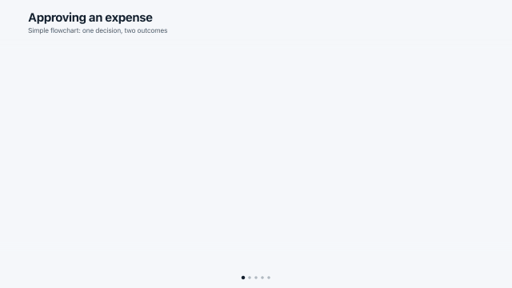

## 02 A larger flowchart

Ten boxes, two plates, two capped loops and a zoom onto one part.
[Spec](../examples/02-flow-complex.json)

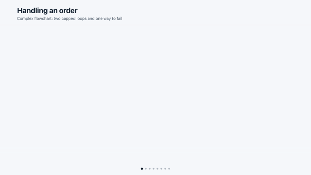

## 03 A simple AWS diagram

A serverless web app on one layer. [Spec](../examples/03-aws-simple.json)

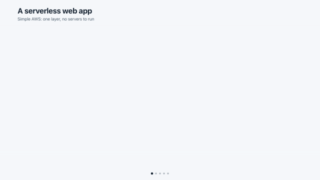

## 04 An AWS landscape

Three layers, with a VPC plate holding public and private subnets.
[Spec](../examples/04-aws-landscape.json)

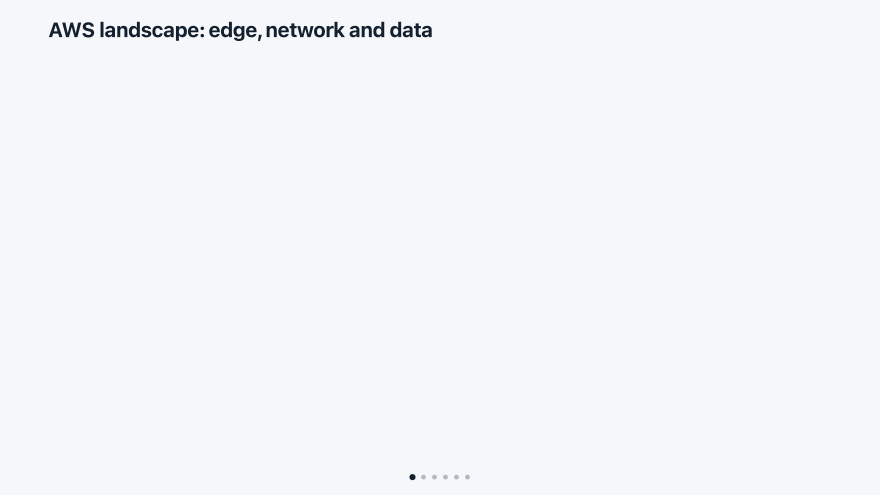

## 05, 06, 07 One scene in three views

The same event-driven design drawn flat, isometric and in 3D.
Specs: [flat](../examples/05-aws-events-flat.json),
[isometric](../examples/06-aws-events-iso.json),
[3D](../examples/07-aws-events-3d.json)

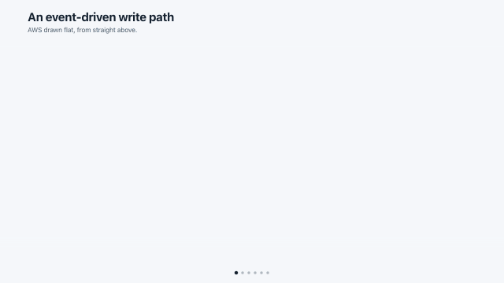

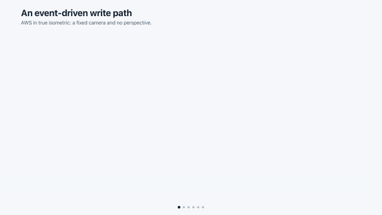

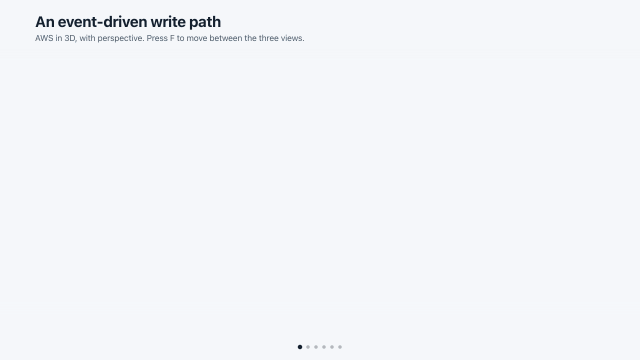

## 08 A request through a gateway

Two layers and a fail path. [Spec](../examples/08-request-flow.json)

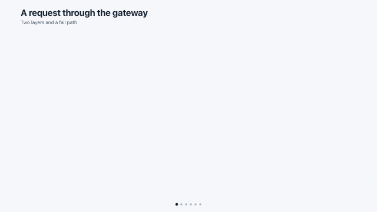

## 09 An agent loop with a cap

[Spec](../examples/09-agent-loop.json)

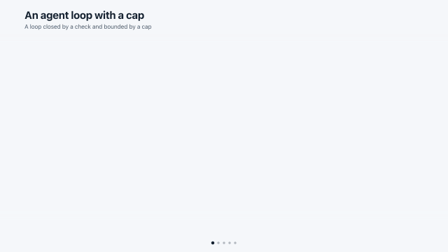

## 10 Fifty components

The whole map, then a guided tour. [Spec](../examples/10-platform-50.json)

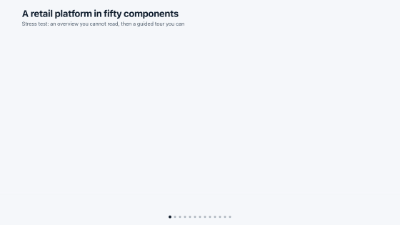

## 11 AWS services and line routing

27 services and 29 lines. Each step shows one routing rule.
[Spec](../examples/11-aws-routing.json)

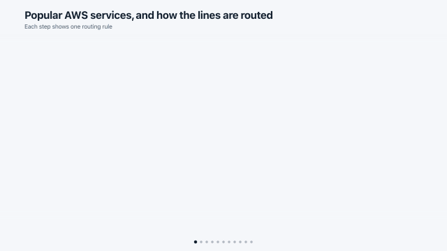
