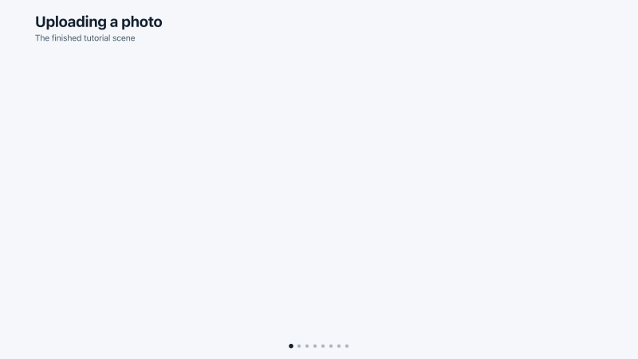
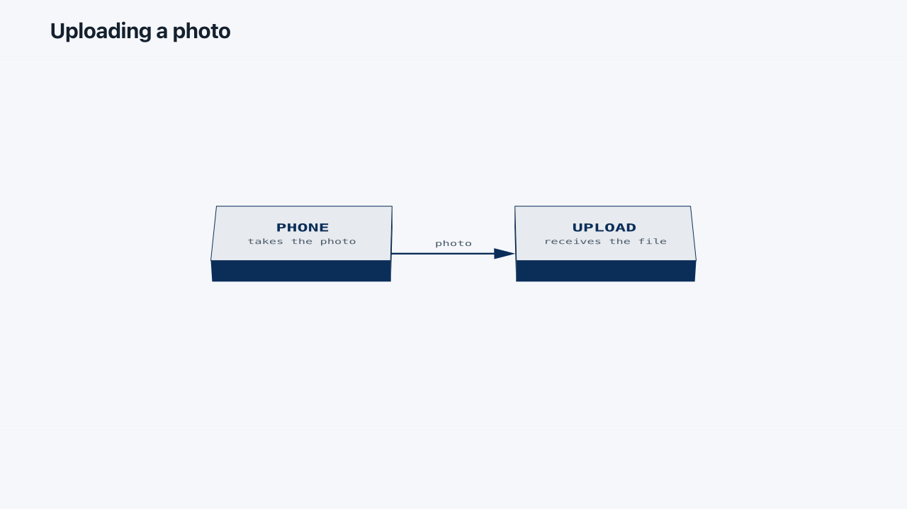
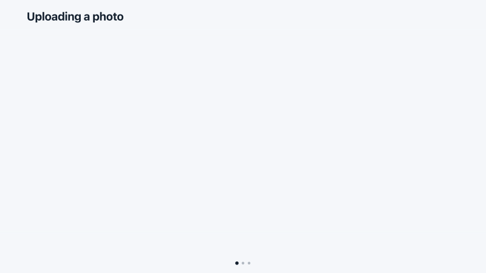
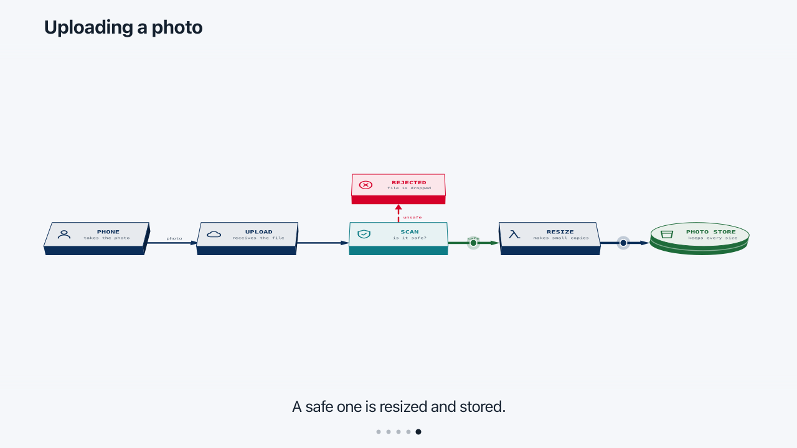
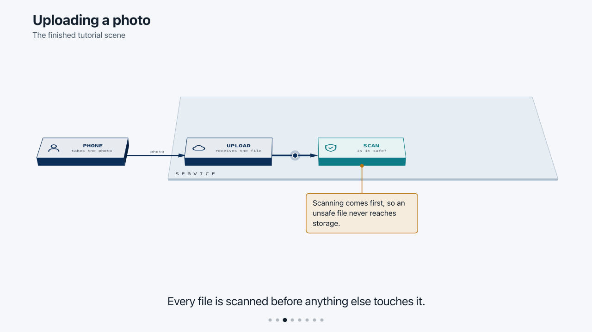
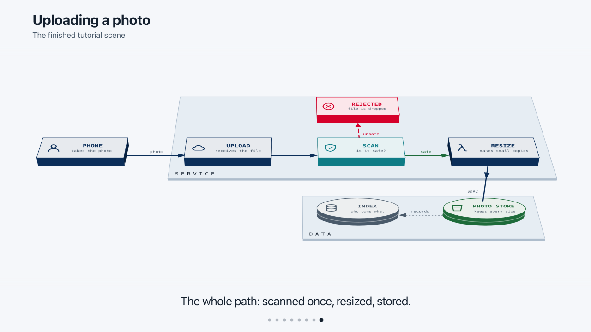
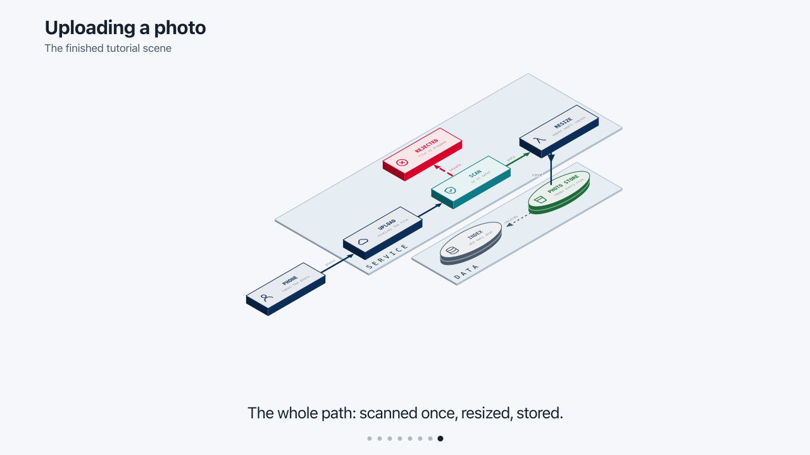
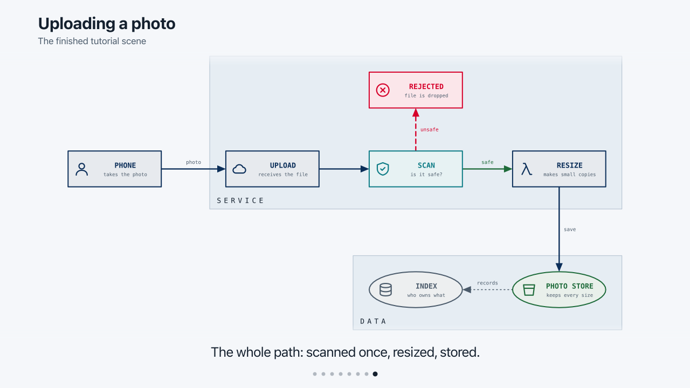

# Tutorial: your first scene

This builds one diagram from nothing, in about twenty minutes: a photo upload
service. Each part adds one idea. The finished scene looks like this:



The spec for each part is in [`examples/tutorial`](../examples/tutorial), so
you can run any of them without typing.

## Before you start

You need [Bun](https://bun.sh). Then:

```sh
git clone https://github.com/DavidROliverBA/scene-plates
cd scene-plates
bun install
```

Three commands do nearly everything:

```sh
bun src/cli.ts check my.json              # is the spec sound?
bun src/cli.ts html my.json -o my.html    # make a page you can open
open my.html                              # arrows, space or click to step
```

## Part 1: two boxes and a line

Make a file called `my.json`:

```json
{
  "title": "Uploading a photo",
  "description": "A phone sends a photo to an upload service.",
  "nodes": [
    { "id": "phone", "label": "PHONE", "sub": "takes the photo", "at": [0, 0] },
    { "id": "upload", "label": "UPLOAD", "sub": "receives the file", "at": [3.4, 0] }
  ],
  "edges": [
    { "from": "phone", "to": "upload", "label": "photo" }
  ]
}
```



What each part means:

- **`title`** is drawn at the top. **`description`** is read out by screen
  readers, so say what the diagram shows.
- **`nodes`** are the boxes. `label` is the name, in capitals. `sub` is a few
  words on what it does.
- **`at`** is where the box sits on a grid: `[column, row]`. Columns run left
  to right. Rows run from the back towards you. A box is 2 wide and 1 deep,
  so columns 0, 3.4, 6.8 and 10.2 leave a comfortable gap.
- **`edges`** are the lines. You say only which boxes they join. The runtime
  works out the path and the arrowhead.

You never give a colour, a font or a pixel position. Those come from one
file, `src/tokens.ts`, so every diagram matches.

## Part 2: tell it in steps

A deck diagram should build as you talk. Add a third box and a `steps` list:

```json
"nodes": [
  { "id": "phone", "label": "PHONE", "sub": "takes the photo", "at": [0, 0] },
  { "id": "upload", "label": "UPLOAD", "sub": "receives the file", "at": [3.4, 0] },
  { "id": "resize", "label": "RESIZE", "sub": "makes small copies", "at": [6.8, 0] }
],
"edges": [
  { "from": "phone", "to": "upload", "label": "photo" },
  { "from": "upload", "to": "resize" }
],
"steps": [
  { "caption": "It starts with a photo on a phone.", "show": ["phone"] },
  { "caption": "The phone sends it to the upload service.", "show": ["upload"], "pulse": ["phone>upload"] },
  { "caption": "The service hands it on to be resized.", "show": ["resize"], "pulse": ["upload>resize"] }
]
```



- **`show`** drops boxes in. They stay until a later step hides them. A line
  appears by itself once both its ends are on screen.
- **`pulse`** sends a dot along a line. A line's name is `from>to`.
- **`caption`** is one full sentence under the scene, 84 characters at most.

Write the captions first. If you cannot say what a step adds, drop the step.

## Part 3: colour, icons and shapes

Colour carries meaning here. It is never decoration. A box's `kind` sets it:

| `kind` | Colour | Means |
|---|---|---|
| `process` (the default) | navy | a normal step |
| `gate` | teal | a check or decision |
| `fail` | red | rejected or stopped. Nothing else is ever red |
| `success` | green | approved, stored, the source of truth |
| `quiet` | grey | supporting parts such as caches and logs |

Lines have kinds too: `flow` (default), `pass` (green), `fail` (red, dashed),
`quiet` (grey, dotted) and `loop` (amber, and it must carry a label stating
its cap, such as "max 3 tries").

Add a scan that can reject a file, and a store drawn as a cylinder:

```json
{ "id": "scan", "label": "SCAN", "sub": "is it safe?", "kind": "gate", "icon": "shield", "at": [8, 0], "size": [2.6, 1] },
{ "id": "reject", "label": "REJECTED", "sub": "file is dropped", "kind": "fail", "icon": "stop", "at": [8, -2.2], "size": [2.6, 1] },
{ "id": "store", "label": "PHOTO STORE", "sub": "keeps every size", "kind": "success", "shape": "cylinder", "icon": "storage", "at": [16, 0], "size": [2.6, 1] }
```

```json
{ "from": "scan", "to": "reject", "kind": "fail", "label": "unsafe" },
{ "from": "scan", "to": "resize", "kind": "pass", "label": "safe" }
```



- **`icon`** adds a small picture. There are 24 built in; the
  [README](../README.md#icons-cylinders-titles-and-callouts) lists them. You
  can also [use your own](../README.md#your-own-icons): any SVG, PNG, JPEG,
  WebP or GIF. An
  icon takes room, so give those boxes `"size": [2.6, 1]` and put columns 4
  apart (0, 4, 8, 12).
- **`"shape": "cylinder"`** is for databases and stores.
- **`focus`** in a step dims everything except the boxes you name. Use it
  with `pulse` to point at what the caption is about:

```json
{ "caption": "An unsafe file stops here.", "show": ["reject"], "focus": ["scan", "reject"], "pulse": ["scan>reject"] }
```

The whole spec is [`3-meaning.json`](../examples/tutorial/3-meaning.json).

## Part 4: plates, layers, callouts and the camera

**Plates** group boxes. **Layers** stack groups in 3D. Give each box a
`layer` (0 is the bottom) and list the groups:

```json
{ "id": "resize", "label": "RESIZE", "sub": "makes small copies", "icon": "function", "at": [12.4, 0], "size": [2.6, 1], "layer": 1 },
{ "id": "store", "label": "PHOTO STORE", "sub": "keeps every size", "kind": "success", "shape": "cylinder", "icon": "storage", "at": [12.4, 0], "size": [2.6, 1], "layer": 0 }
```

```json
"groups": [
  { "id": "service", "label": "SERVICE", "contains": ["upload", "scan", "reject", "resize"] },
  { "id": "data", "label": "DATA", "contains": ["store", "index"] }
]
```

A line between layers needs one box directly above the other. Here `resize`
and `store` share the same `at`, so the line between them is a straight drop.

**Callouts** say what a label cannot. Define one, then show it in a step:

```json
"callouts": [
  { "id": "why-first", "text": "Scanning comes first, so an unsafe file never reaches storage.", "on": "scan", "side": "down" }
]
```

```json
{ "caption": "Every file is scanned before anything else touches it.", "show": ["scan"], "pulse": ["upload>scan"], "callout": ["why-first"] }
```



**The camera** looks straight on by default. A step can tilt it, zoom it, or
point it at part of the scene:

```json
{ "caption": "The copies are kept on the data layer underneath.", "show": ["data"], "camera": { "pitch": 32 } },
{ "caption": "Look closer: one store for the files, one index of who owns them.", "camera": { "target": ["data"], "zoom": 1.5 } },
{ "caption": "The whole path: scanned once, resized, stored.", "camera": { "target": null, "zoom": 1, "pitch": 38 } }
```

- **`pitch`** is the tilt, from 25 (low, shows layers well) to 70 (nearly
  from above). The default is 38.
- **`target`** and **`zoom`** move in on the boxes or plates you name.
  `"target": null` goes back to the whole scene.
- **`yaw`** turns the scene to an angle, from -45 to 45. The default is 0,
  straight on. Use it only if you want the angled look.

A camera move lasts until a later step changes it. Two or three moves in a
scene is plenty. End on the whole picture.

The finished spec is
[`4-photo-upload.json`](../examples/tutorial/4-photo-upload.json): 7 boxes,
8 steps, about 40 lines.

## Part 5: when the checker says no

The checker is the point of the tool. It refuses diagrams that would read
badly, and its messages say what to change. Try
[`broken.json`](../examples/tutorial/broken.json):

```sh
bun src/cli.ts check examples/tutorial/broken.json
```

```
examples/tutorial/broken.json: 2 problems
  - Loop edge "scan>upload" needs a label that states its cap, such as "max 3 tries".
  - Step 1: pulse "scan>store" is not an edge. Edge ids look like "from>to".
```

It checks the spec's structure first. Fix those two and run it again, and it
moves on to the drawing:

```
5 problems
  - Label "UPLOAD SERVICE FOR PHOTOS" is too long for node "upload" (14 characters fit). Shorten it or widen the node.
  - Nodes "upload" and "retry" overlap.
  - Edge "phone>store" runs through node "upload". Change "via" or "channel", or move the node.
  - Edge "phone>store" runs through node "scan". Change "via" or "channel", or move the node.
  - Edges "upload>scan" and "phone>store" run along each other or meet. Give one a different "channel" or an "offset".
```

| Message | Usual fix |
|---|---|
| label too long | shorten it, or widen the box with `size` |
| nodes overlap | move one; keep 1.4 between boxes |
| a line runs through a box | move the box, or send the line round with `via` and `channel` |
| two lines cross or run together | reorder the boxes, or give one line a different `channel` or `offset` |
| too big to read | move boxes closer, split the scene, or tour it with camera steps |
| a callout covers a box or leaves the frame | change its `side` or `gap` |

Lines are not routed automatically. Place boxes in the order the work flows
and most lines come out straight. For the rest, see
[How lines are routed](../README.md#how-lines-are-routed), and run this to
see what each line did:

```sh
bun src/cli.ts routes examples/tutorial/4-photo-upload.json
```

```
phone>upload             straight  the two boxes line up
upload>scan              straight  the two boxes line up
scan>reject              straight  the two boxes line up
scan>resize              straight  the two boxes line up
resize>store             riser     between layers
store>index              straight  the two boxes line up
```

## Part 6: three views

The same spec draws three ways. Nothing in it changes.

| 3D (default) | Isometric | Flat |
|---|---|---|
|  |  |  |

```sh
bun src/cli.ts check my.json --view iso     # does it also work in isometric?
bun src/cli.ts check my.json --view flat
```

Set `"view": "iso"` in the spec to make one the default. In a deck, the
3D / Isometric / Flat control at the top right, or the F key, switches while
you present. It offers only the views that pass the checker.

## Part 7: put it to use

**A standalone deck.** One file, no network needed:

```sh
bun src/cli.ts html examples/tutorial/*.json -o tutorial.html
```

**In your own page or deck.** Copy `dist/scene-plates.min.js` next to it:

```html
<script src="scene-plates.min.js"></script>
<scene-plate src="diagrams/photo-upload.json" toggle></scene-plate>
```

**Stills and GIFs**, for documents and articles:

```sh
bun src/cli.ts svg my.json --all -o out/     # one still per step
bun scripts/gif.ts my.json my.gif            # needs rsvg-convert and ffmpeg
```

**With an AI model.** The repo has a ready-made skill for Claude Code in
[`skill/scene-plates`](../skill/scene-plates/SKILL.md). The model writes the
spec and runs the checker; it never writes drawing code. Ask for something
like "an animated diagram of our sign-in flow, five steps".

## Cheat sheet

| You want | Write |
|---|---|
| a box | `{ "id", "label", "sub", "at": [col, row] }` |
| a meaning | `"kind": "gate"`, `"fail"`, `"success"` or `"quiet"` |
| an icon | `"icon": "shield"` and `"size": [2.6, 1]` |
| your own icon | `"icons": { "logo": "art/logo.svg" }`, then `"icon": "logo"` |
| a database | `"shape": "cylinder"` |
| a line | `{ "from", "to", "label" }` |
| a plate | `"groups": [{ "id", "label", "contains": [...] }]` |
| a layer below | `"layer": 0` on the lower boxes, `1` on the upper |
| a note | `"callouts": [{ "id", "text", "on", "side" }]`, then `"callout": ["id"]` in a step |
| to reveal | `"show": [...]` |
| to point | `"focus": [...]` and `"pulse": ["a>b"]` |
| to move in | `"camera": { "target": [...], "zoom": 1.5 }` |
| to tilt | `"camera": { "pitch": 32 }` |

Next: look through the [gallery](gallery.md), and copy the example nearest to
what you need.
